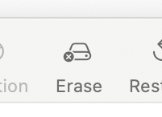
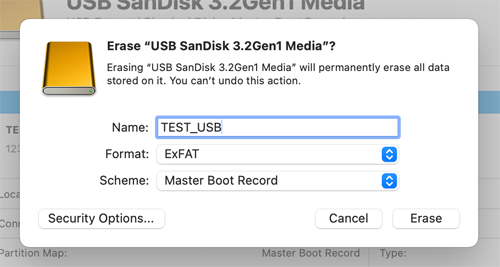
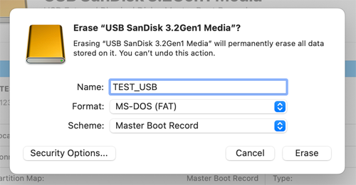
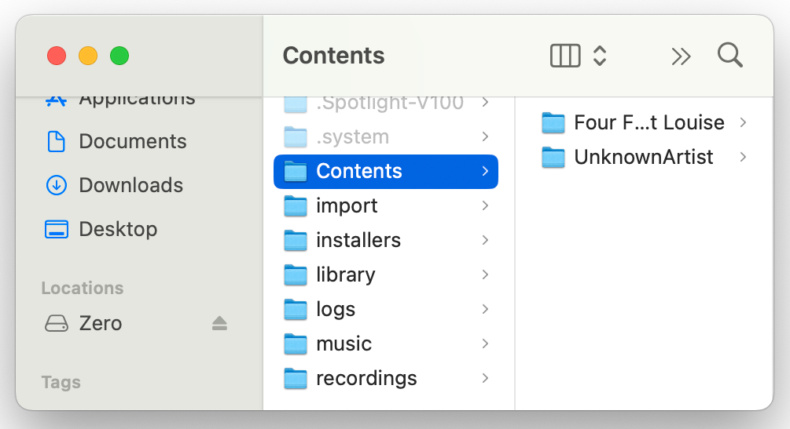
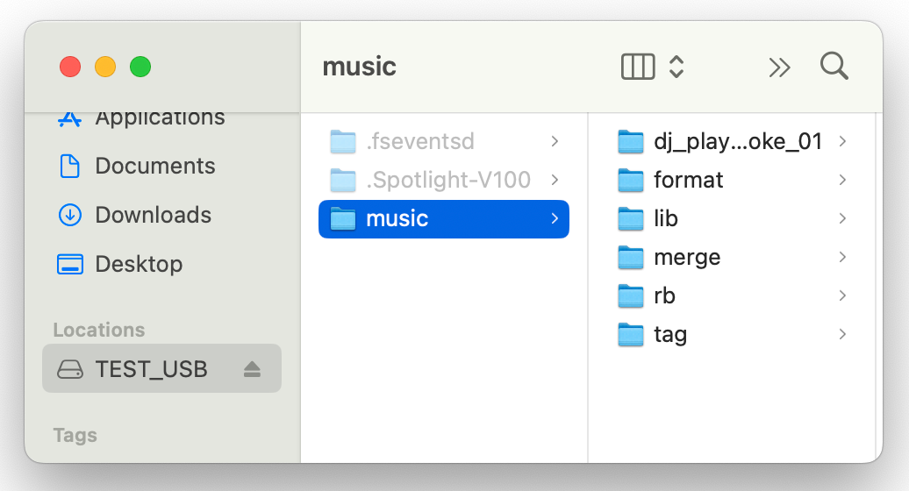

## CONF.FILE.1
**Format ExFAT Drive MacOS**

| ID           | Action |
| :------------------- | :-------- |
| CONF.FILE.1.0 | Attach USB-C thumb drive to MacOS host computer |
| CONF.FILE.1.1 | Launch Disk Utility App |
| CONF.FILE.1.2 | Enable menu item **View** > **Show All Devices** |
| CONF.FILE.1.3 | <ul><li>Select the top-level device of thumb drive</li><li>Click Erase</li></ul>   |
| CONF.FILE.1.4 | <ul><li>Enter a name</li><li>Set Format = **ExFat**</li><li>Set Scheme = Master Boot Record</li><li>Click Erase</li></ul>  |
| CONF.FILE.1.5 | Verify empty USB drive mounts in Finder |

## CONF.FILE.2
**Format FAT32 Drive MacOS**

| ID           | Action |
| :------------------- | :-------- |
| CONF.FILE.2.0 | Attach USB-C thumb drive to MacOS host computer |
| CONF.FILE.2.1 | Launch Disk Utility App |
| CONF.FILE.2.2 | Enable menu item **View** > **Show All Devices** |
| CONF.FILE.2.3 | <ul><li>Select the top-level device of thumb drive</li><li>Click Erase</li></ul>   |
| CONF.FILE.2.4 | <ul><li>Enter a name</li><li>Set Format = **MS-DOS (FAT)**</li><li>Set Scheme = Master Boot Record</li><li>Click Erase</li></ul>  |
| CONF.FILE.2.5 | Verify empty USB drive mounts in Finder |

## CONF.FILE.3
~~**Format HFS+ Drive MacOS**~~

## CONF.FILE.4
**Load QA Files to Zero**

| ID           | Action |
| :------------------- | :-------- |
| CONF.FILE.4.0 | Put Zero into Drive Mode and attach to host computer |
| CONF.FILE.4.0 | <ul><li>Copy contents of /music dir to /music dir on Zero</li><li>Other files are allowed to be present in Zero's /music dir</li></ul> |
| CONF.FILE.4.0 | <ul><li>Copy /music/rb/Contents dir to root on Zero</li></ul> |

## CONF.FILE.5
**Load QA Files to USB Drive**

| ID           | Action |
| :------------------- | :-------- |
| CONF.FILE.5.0 | Attach FAT32/ExFat USB-C thumb drive to MacOS host computer |
| CONF.FILE.5.1 | <ul><li>Copy /music dir to root of drive</li></ul> |
| CONF.FILE.5.2 | <ul><li>Copy /music/rb/Contents dir to root of drive</li></ul> |
