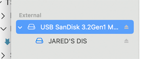

## CONF.FILE.1
**Format ExFAT Drive MacOS**

| ID           | Action |
| :------------------- | :-------- |
| CONF.FILE.1.0 | Attach USB-C thumb drive to MacOS host computer |
| CONF.FILE.1.1 | Launch Disk Utility App |
| CONF.FILE.1.2 | Enable menu item **View** > **Show All Devices** |
| CONF.FILE.1.3 | <ul><li>Select the top-level device of thumb drive</li><li>Click Erase</li></ul>   |
| CONF.FILE.1.4 | <ul><li>Enter a name</li><li>Set Format = **ExFat**</li><li>Set Scheme = Master Boot Record</li><li>Click Erase</li></ul>  |
| CONF.FILE.1.5 | Verify empty USB drive mounts in Finder |