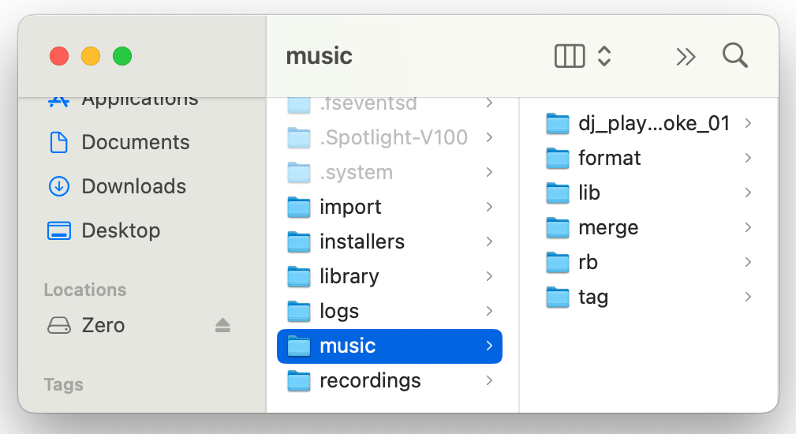

## CONF.FILE.4
**Load QA Files to Zero**

| ID           | Action |
| :------------------- | :-------- |
| CONF.FILE.4.0 | Put Zero into Drive Mode and attach to host computer |
| CONF.FILE.4.0 | <ul><li>Copy contents of /music dir to /music dir on Zero</li><li>Other files are allowed to be present in Zero's /music dir</li></ul> |
| CONF.FILE.4.0 | <ul><li>Copy /music/rb/Contents dir to root on Zero</li></ul> |