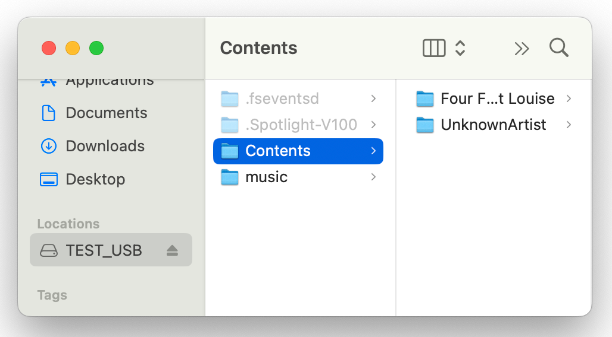

## CONF.FILE.5
**Load QA Files to USB Drive**

| ID           | Action |
| :------------------- | :-------- |
| CONF.FILE.5.0 | Attach FAT32/ExFat USB-C thumb drive to MacOS host computer |
| CONF.FILE.5.1 | <ul><li>Copy /music dir to root of drive</li></ul> |
| CONF.FILE.5.2 | <ul><li>Copy /music/rb/Contents dir to root of drive</li></ul> |
