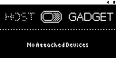

## CONF.USB.3
**Set USB Host Mode**

| ID           | Action | Reference |
| :--- | --------: | :----- |
| CONF.USB.3.0 | Navigate | Control Panels/USB |
| CONF.USB.3.1 | Verify | USB is in Offline Mode ! |
| CONF.USB.3.2 | Select | Host  |
| CONF.USB.3.3 | Verify | USB is in Host Mode  |
