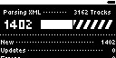
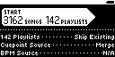
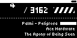

## SMOK.LIB.2
**Large Library Test**

| PASS | FAIL | Build # | Timestamp | User |
| :---: | :---: | :--- | :--- | :--- |
| | | | | |

| Pass |          ID           | Action | Reference |
| :---: | :------------------- | --------: | :------- |
|  | SMOK.LIB.2.0 | Complete | [[TST.SET.2.2.1](../../SET/TST.SET.2_System#tst.set.2.2.1) Library DB Reset] |
|  | SMOK.LIB.2.1 | Navigate | Library/+Add Music/Rekordbox XML  |
|  | SMOK.LIB.2.2 | Select XML | music/rb/large_lib.xml |
|  | SMOK.LIB.2.3 | Select Scan Dir | music/format/mp3 |
|  | SMOK.LIB.2.4 | Verify |  [RB XML Scan] appears |
|  | SMOK.LIB.2.5 | Verify |  [RB XML Import Options] appears |
|  | SMOK.LIB.2.6 | Select | [Start Button] |
|  | SMOK.LIB.2.7 | Verify |  [RB XML analyze] appears |
|  | SMOK.LIB.2.8 | Navigate | /Library/Artists |
|  | SMOK.LIB.2.9 | Verify | Artists Menu loads in < 2 sec. |
|  | SMOK.LIB.2.10 | Navigate | /Library/Genre |
|  | SMOK.LIB.2.11 | Verify | Genre Menu loads in < 2 sec. |
|  | SMOK.LIB.2.12 | Navigate | /Library/BPM |
|  | SMOK.LIB.2.13 | Verify | BPM Menu loads in < 2 sec. |
|  | SMOK.LIB.2.14 | Navigate | /Library/Key |
|  | SMOK.LIB.2.15 | Verify | Key Menu loads in < 2 sec. |
|  | SMOK.LIB.2.16 | Navigate | /Library/Playlists |
|  | SMOK.LIB.2.17 | Verify | Playlists Menu loads in < 2 sec. |