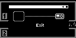
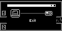

## SMOK.USB.1
**USB Connectivity Test**

| PASS | FAIL | Build # | Timestamp | User |
| :---: | :---: | :--- | :--- | :--- |
| | | | | |

### SMK.USB.1.0
**Reboot + Drive Mode**

| Pass |          ID           | Action | Reference |
| :---: | :------------------- | --------: | :------- |
|  | SMOK.USB.1.0.0 | Reboot | Zero |
|  | SMOK.USB.1.0.1 | Verify | No USB cable is attached |
|  | SMOK.USB.1.0.2 | Navigate | Control Panels/USB |
|  | SMOK.USB.1.0.3 | Verify | USB Mode = Offline |
|  | SMOK.USB.1.0.4 | Navigate | Library/+Add Music |
|  | SMOK.USB.1.0.5 | Verify | Drive Mode appears w/empty host  |
|  | SMOK.USB.1.0.6 | Connect | USB-C cable between host and Zero |
|  | SMOK.USB.1.0.7 | Verify | Host icon appears  |
|  | SMOK.USB.1.0.8 | Verify | Zero mounts on Host OS |

**If Zero has mounted on Host, test has passed.**

**If Zero has not mounted on Host, continue to [SMOK.USB.1.1.0].**

### SMK.USB.1.1
**Drive Mode Cable Polarity Check**

| Pass |          ID           | Action | Reference |
| :---: | :------------------- | --------: | :------- |
|  | SMOK.USB.1.1.0 | Disconnect | USB-C Cable |
|  | SMOK.USB.1.1.1 | Connect | USB-C Cable |
|  | SMOK.USB.1.1.2 | Verify | Zero mounts on Host OS after 2 seconds |
|  | SMOK.USB.1.1.3 | Disconnect | USB-C Cable |
|  | SMOK.USB.1.1.4 | Rotate | USB-C Cable Plug 180 degrees |
|  | SMOK.USB.1.1.5 | Connect | USB-C Cable |
|  | SMOK.USB.1.1.6 | Verify | Zero mounts on Host OS after 2 seconds |

**If Zero has not mounted on Host, test has failed.**

**Continue to [USB Troubleshooting]**
