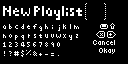
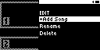

#### TST.LIB.1.2
**New Playlist**

| PASS | FAIL | Build # | Timestamp | User |
| :---: | :---: | :--- | :--- | :--- |
| | | | | |

| Pass |          ID           | Action | Reference |
| :---: | :------------------- | --------: | :------- |
| ✅ | TST.LIB.1.2.0 | Configure | [[CONF.LIB.1](../../../CONF/LIB/CONF.LIB.1_Simple_QA_Lib.md) Install QA Lib: Simple] |
| ✅ | TST.LIB.1.2.1 | Navigate | Library/Playlists/+Add Playlist |
| ✅ | TST.LIB.1.2.2 | Verify |  [Text Edit View] appears |
| ✅ | TST.LIB.1.2.3 | Select | [Okay] |
| ✅ | TST.LIB.1.2.4 | Verify |  [New Playlist] appears in Menu |

| Notes | 
| :--- |
|  |
