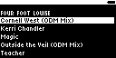
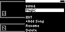
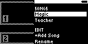
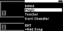

#### TST.LIB.1.3
**Add Song**

| PASS | FAIL | Build # | Timestamp | User |
| :---: | :---: | :--- | :--- | :--- |
| | | | | |

| Pass |          ID           | Action | Reference |
| :---: | :------------------- | --------: | :------- |
|  | TST.LIB.1.3.0 | Complete | [[TST.LIB.1.2](TST.LIB.1.2_Playlist_New.md) New Playlist] |
|  | TST.LIB.1.3.1 | Navigate | Library/Playlists/New Playlist/+Add Song |
|  | TST.LIB.1.3.2 | Verify |  [Add Song Menu] appears |
|  | TST.LIB.1.3.3 | Select | Magic |
|  | TST.LIB.1.3.4 | Verify |  [Playlist Menu] appears  Songs<ul><li>Magic</li></ul> |
|  | | | |
|  | TST.LIB.1.3.5 | Navigate | Library/Playlists/New Playlist/+Add Song |
|  | TST.LIB.1.3.6 | Select | Teacher |
|  | TST.LIB.1.3.7 | Verify |  [Playlist Menu] appears  Songs<ul><li>Magic</li><li>Teacher</li></ul> |
|  | | | |
|  | TST.LIB.1.3.8 | Navigate | Library/Playlists/New Playlist/+Add Song |
|  | TST.LIB.1.3.9 | Select | Kerri Chandler |
|  | TST.LIB.1.3.10 | Verify |  [Playlist Menu] appears  Songs<ul><li>Magic</li><li>Teacher</li><li>Kerri Chandler</li></ul> |

| Notes | 
| :--- |
|  |