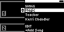
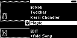
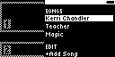

#### TST.LIB.1.4

**Move Song**

| PASS | FAIL | Build # | Timestamp | User |
| :---: | :---: | :--- | :--- | :--- |
| | | | | |

| Pass |          ID           | Action | Reference |
| :---: | :------------------- | --------: | :------- |
|  | TST.LIB.1.4.0 | Complete | [[TST.LIB.1.3](TST.LIB.1.3_Playlist_Add_Song.md) New Playlist] |
|  | TST.LIB.1.4.1 | Navigate |  Library/Playlists/New Playlist/Magic/Move Song Option |
|  | TST.LIB.1.4.2 | Move |  Move [Magic] to last item in playlist |
|  | TST.LIB.1.4.3 | Move |  Move [Kerri Chandler] to first item in playlist |
|  | TST.LIB.1.4.4 | Navigate | Back to Library/Playlists |
|  | TST.LIB.1.4.5 | Navigate | Return to Library/Playlists/New Playlist |
|  | TST.LIB.1.4.6 | Verify | [Playlist Menu] appears in new order: <ul><li>Kerri Chandler</li><li>Teacher</li><li>Magic</li></ul> |

| Notes | 
| :--- |
|  |