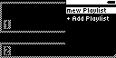

#### TST.LIB.1.5
**Rename Playlist**

| PASS | FAIL | Build # | Timestamp | User |
| :---: | :---: | :--- | :--- | :--- |
| | | | | |

| Pass |          ID           | Action | Reference |
| :---: | :------------------- | --------: | :------- |
|  | TST.LIB.1.5.0 | Complete | [[TST.LIB.1.4](TST.LIB.1.4_Playlist_Move_Song.md) Move Song in Playlist] |
|  | TST.LIB.1.5.1 | Navigate | Library/Playlists/New Playlist/Rename |
|  | TST.LIB.1.5.2 | Verify |  [Text Input View] appears |
|  | TST.LIB.1.5.3 | Text Input | Change Playlist name to "mew playlist" |
|  | TST.LIB.1.5.4 | Navigate | Back to Library/Playlists |
|  | TST.LIB.1.5.5 | Verify |  [mew playlist] appears in list |

| Notes | 
| :--- |
|  |