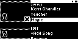
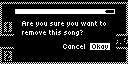
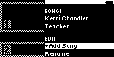

#### TST.LIB.1.6
**Remove Song**

| PASS | FAIL | Build # | Timestamp | User |
| :---: | :---: | :--- | :--- | :--- |
| | | | | |

| Pass |          ID           | Action | Reference |
| :---: | :------------------- | --------: | :------- |
|  | TST.LIB.1.6.0 | Complete | [[TST.LIB.1.5](TST.LIB.1.5_Playlist_Rename.md) Rename Playlist] |
|  | TST.LIB.1.6.1 | Navigate |  Library/Playlists/mew Playlist/Magic/Remove Option |
|  | TST.LIB.1.6.2 | Verify |  [Confirm Dialog] appears |
|  | TST.LIB.1.6.3 | Select | [Okay] |
|  | TST.LIB.1.6.4 | Verify |  Magic is removed from Playlist Menu: <ul><li>Kerri Chandler</li><li>Teacher</li></ul> |
|  | TST.LIB.1.6.5 | Navigate | Back to Library/Playlists |
|  | TST.LIB.1.6.6 | Navigate | Return to Library/Playlists/mew Playlist |
|  | TST.LIB.1.6.7 | Verify | [Playlist Menu] appears in same order: <ul><li>Kerri Chandler</li><li>Teacher</li></ul> |

| Notes | 
| :--- |
|  |