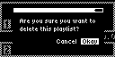
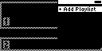

#### TST.LIB.1.7
**Delete Playlist**

| PASS | FAIL | Build # | Timestamp | User |
| :---: | :---: | :--- | :--- | :--- |
| ✅ | | | | |

| Pass |          ID           | Action | Reference |
| :---: | :------------------- | --------: | :------- |
| ✅ | TST.LIB.1.7.0 | Complete | [[TST.LIB.1.6](TST.LIB.1.6_Playlist_Remove_Song.md) Remove Song from Playlist] |
| ✅ | TST.LIB.1.7.1 | Navigate | Library/Playlists/mew Playlist/Delete |
| ✅ | TST.LIB.1.7.2 | Verify |  [Confirm Dialog] appears |
| ✅ | TST.LIB.1.7.3 | Select | [Okay] |
| ✅ | TST.LIB.1.7.4 | Verify |  Empty [Playlists Menu] appears |

| Notes | 
| :--- |
|  |
