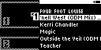
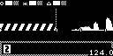
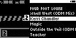
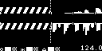

#### TST.LIB.2.0
**Artists Menu - Load Song**

| PASS | FAIL | Build # | Timestamp | User |
| :---: | :---: | :--- | :--- | :--- |
| | | | | |

| Pass |          ID           | Action | Reference |
| :---: | :------------------- | --------: | :------- |
|  | TST.LIB.2.0.0 | Configure | [[CONF.LIB.3](../../../CONF/LIB/CONF.LIB.3_DJ_Smoke_Test_Lib.md) Install QA Lib: DJ Smoke Test] |
|  | TST.LIB.2.0.1 | Navigate |  Library/Artists/Four Foot Louise/Cornell West/Deck 1 Option |
|  | TST.LIB.2.0.2 | Verify |  [Playback Deck 1] appears (Cornell West loaded) |
|  | | | |
|  | TST.LIB.2.0.3 | Navigate |  Library/Artists/Four Foot Louise/Kerri Chandler/Deck 2 Option |
|  | TST.LIB.2.0.4 | Verify |  [Playback Deck 2] appears (Kerri Chandler loaded) |
|  | | | |
|  | TST.LIB.2.0.5 | Navigate | Library/Artists |
|  | TST.LIB.2.0.6 | Scroll Menu | Magic |
|  | TST.LIB.2.0.7 | Press | Deck 1 Button |
|  | TST.LIB.2.0.8 | Verify | [Playback Deck 1] appears (Magic loaded) |
|  | | | |
|  | TST.LIB.2.0.9 | Navigate | Library/Artists |
|  | TST.LIB.2.0.10 | Scroll Menu | Outside the Veil |
|  | TST.LIB.2.0.11 | Press | Deck 2 Button |
|  | TST.LIB.2.0.12 | Verify | [[Playback Deck 2] appears (Outside the Veil loaded) |

| Notes | 
| :--- |
|  |