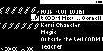
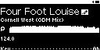

#### TST.LIB.2.1
**Artists Menu - Edit Song**

| PASS | FAIL | Build # | Timestamp | User |
| :---: | :---: | :--- | :--- | :--- |
| | | | | |

| Pass |          ID           | Action | Reference |
| :---: | :------------------- | --------: | :------- |
|  | TST.LIB.2.1.0 | Configure | [[CONF.LIB.3](../../../CONF/LIB/CONF.LIB.3_DJ_Smoke_Test_Lib.md) Install QA Lib: DJ Smoke Test] |
|  | TST.LIB.2.1.1 | Navigate |  Library/Artists/Four Foot Louise/Cornell West/Edit Song Option |
|  | TST.LIB.2.1.2 | Verify |  [Song Edit View] appears (Cornell West loaded) |

| Notes | 
| :--- |
|  |