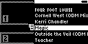

#### TST.LIB.2.2
**Artists Menu - Add Song to Playlist**

| PASS | FAIL | Build # | Timestamp | User |
| :---: | :---: | :--- | :--- | :--- |
| | ❌ | | | |

| Pass |          ID           | Action | Reference |
| :---: | :------------------- | --------: | :------- |
| ✅ | TST.LIB.2.2.0 | Configure | [[CONF.LIB.3](../../../CONF/LIB/CONF.LIB.3_DJ_Smoke_Test_Lib.md) Install QA Lib: DJ Smoke Test] |
| ✅ | TST.LIB.2.2.1 | Navigate |  Library/Artists/Four Foot  Louise/Magic/Add to Playlist Option |
| ✅ | TST.LIB.2.2.2 | Verify |  [Select Playlist] appears |
| ✅ | TST.LIB.2.2.3 | Select | [Techno] |
| ✅ | TST.LIB.2.2.4 | Navigate | Library/Playlists/Techno |
| ❌ | TST.LIB.2.2.5 | Verify | [Playlist Menu] appears in order: <ul><li>The Legend of Pat Nice</li><li>Outside the Veil (ODM Mix)</li><li>Magic</li></ul> |

| Notes | 
| :--- |
| Magic appears second in list. It should be at the end |
