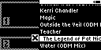

#### TST.LIB.2.3
**Artists Menu - Remove Song**

| PASS | FAIL | Build # | Timestamp | User |
| :---: | :---: | :--- | :--- | :--- |
| ✅ | | | | |

| Pass |          ID           | Action | Reference |
| :---: | :------------------- | --------: | :------- |
| ✅ | TST.LIB.2.3.0 | Configure | [[CONF.LIB.3](../../../CONF/LIB/CONF.LIB.3_DJ_Smoke_Test_Lib.md) Install QA Lib: DJ Smoke Test] |
| ✅ | TST.LIB.2.3.1 | Navigate |  Library/Artists/Four Foot  Louise/The Legend of Pat Nice/Delete Song Option |
| ✅ | TST.LIB.2.3.2 | Verify |  [Confirm Dialog] appears |
| ✅ | TST.LIB.2.3.3 | Select | [Okay] |
| ✅ | TST.LIB.2.3.4 | Verify | Artists Menu Contents:<ul><li>Cornell West</li><li>Kerri Chandler</li><li>Magic</li><li>Outside the Veil</li><li>Teacher</li><li>Water</li></ul> |
| ✅ | TST.LIB.2.3.5 | Navigate | Library/Playlists/Mix |
| ✅ | TST.LIB.2.3.6 | Verify | Playlist Order:<ul><li>Water</li><li>Cornell West</li><li>Outside the Veil</li><li>Kerri Chandler</li></ul> |

| Notes | 
| :--- |
|  |
