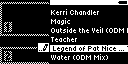
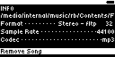

#### TST.LIB.8.12
**Song Edit - Remove Song**

| PASS | FAIL | Build # | Timestamp | User |
| :---: | :---: | :--- | :--- | :--- |
| | | | | |

| Pass |          ID           | Action | Reference |
| :---: | :------------------- | --------: | :------- |
|  | TST.LIB.8.12.0 | Configure | [[CONF.LIB.3](../../../CONF/LIB/CONF.LIB.3_DJ_Smoke_Test_Lib.md) Install QA Lib: DJ Smoke Test] |
|  | TST.LIB.8.12.1 | Navigate |  Library/Artists/Four Foot Louise/The Legend of Pat Nice/Edit Song Option |
|  | TST.LIB.8.12.2 | Select |  [Remove Song] |
|  | TST.LIB.8.12.3 | Verify |  [Confirm Dialog] appears |
|  | TST.LIB.8.12.4 | Select | [Okay] |
|  | TST.LIB.8.12.5 | Verify | Artists Menu Contents:<ul><li>Cornell West</li><li>Kerri Chandler</li><li>Magic</li><li>Outside the Veil</li><li>Teacher</li><li>Water</li></ul> |
|  | TST.LIB.8.12.6 | Navigate | Library/Playlists/Mix |
|  | TST.LIB.8.12.7 | Verify | Playlist Order:<ul><li>Water</li><li>Cornell West</li><li>Outside the Veil</li><li>Kerri Chandler</li></ul> |

| Notes | 
| :--- |
|  |