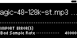
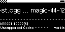

## TST.LIB.9.0.0
**New File - Empty Library** 
Import a single audio file into an empty Library

| PASS | FAIL | Build # | Timestamp | User |
| :---: | :---: | :--- | :--- | :--- |
| | | | | |

| Pass |          ID           | Action | Reference |
| :---: | :------------------- | --------: | :------- |
|  | TST.LIB.9.0.0.0 | Complete | [[TST.SET.2.2.1](../../SET/TST.SET.2_System#tst.set.2.2.1) Library DB Reset] |
|  | TST.LIB.9.0.0.1 | Navigate | Library/+Add Music/Browse Files  |
|  | TST.LIB.9.0.0.2 | File Browse | music/tag/t4/magic-F-123_t4.mp3 |
|  | TST.LIB.9.0.0.3 | Verify | ![[UI.LIB.X.X.X] New](images/TST.LIB.9.0.0.3.bmp) [[Single File Import Options](../../../UI/LIB/UI.LIB.Library_Menu.md#UI.LIB.X.X.X)] appears |
|  | TST.LIB.9.0.0.4 | Select | ![[UI.LIB.X.X.X] New](images/TST.LIB.9.0.0.4.bmp) [[Single File Import Button](../../../UI/LIB/UI.LIB.Library_Menu.md#UI.LIB.X.X.X)] |
|  | TST.LIB.9.0.0.5 | Navigate | Library/Artists |
|  | TST.LIB.9.0.0.6 | Verify | <ul><li>Zero QA Artist<ul><li>Magic</li></ul></li></ul><ul> | 

| Notes | 
| :--- |
|  |

## TST.LIB.9.0.1
**New File - Populated Library** 
Import a single audio file into a Library which already contains songs -- song doesn't exist in Library

| PASS | FAIL | Build # | Timestamp | User |
| :---: | :---: | :--- | :--- | :--- |
| | | | | |

| Pass |          ID           | Action | Reference |
| :---: | :------------------- | --------: | :------- |
|  | TST.LIB.9.0.1.0 | Complete | [[TST.LIB.9.0.0](#TST.LIB.9.0.0) New File - Empty Library] |
|  | TST.LIB.9.0.1.1 | Navigate | Library/+Add Music/Browse Files |
|  | TST.LIB.9.0.1.2 | File Browse | music/tag/t4/veil-Ebm-125_t4.mp3 |
|  | TST.LIB.9.0.1.3 | Verify | ![[UI.LIB.X.X.X] New](images/TST.LIB.9.0.1.3.bmp) [[Single File Import Options](../../../UI/LIB/UI.LIB.Library_Menu.md#UI.LIB.X.X.X)] appears |
|  | TST.LIB.9.0.1.4 | Select | ![[UI.LIB.X.X.X] New File Options](images/TST.LIB.9.0.1.4.bmp) [[Single File Import Button](../../../UI/LIB/UI.LIB.Library_Menu.md#UI.LIB.X.X.X)] |
|  | TST.LIB.9.0.1.5 | Navigate | Library/Artists |
|  | TST.LIB.9.0.1.6 | Verify | <ul><li>Zero QA Artist<ul><li>Magic</li><li>Veil</li></ul></li></ul><ul> | 

| Notes | 
| :--- |
|  |

## TST.LIB.9.0.2
**Existing file - Update BPM/Key** 
Import a single, pre-existing audio file -- overwrite Library metadata with file's metadata

| PASS | FAIL | Build # | Timestamp | User |
| :---: | :---: | :--- | :--- | :--- |
| | | | | |

| Pass |          ID           | Action | Reference |
| :---: | :------------------- | --------: | :------- |
|  | TST.LIB.9.0.2.0 | Complete | [[TST.LIB.9.0.1](#TST.LIB.9.0.1) New File - Populated Library] |
|  | TST.LIB.9.0.2.1 | Settings | <ul><li>UI/Library Menu/Show BPM = true</li><li>UI/Library Menu/Show Key = true</li></ul> |
|  | TST.LIB.9.0.2.2 | Navigate | Library/+Add Music/Browse Files |
|  | TST.LIB.9.0.2.3 | File Browse | music/tag/t4/magic-A-130_t4.mp3 |
|  | TST.LIB.9.0.2.4 | Verify | ![[UI.LIB.X.X.X] Update File](images/TST.LIB.9.0.2.3.bmp) [[Single File Update Options](../../../UI/LIB/UI.LIB.Library_Menu.md#UI.LIB.X.X.X.1)] appears |
|  | TST.LIB.9.0.2.5 | Set | ![[UI.LIB.X.X.X.1] BPM/Key Source](images/TST.LIB.9.0.2.4.bmp) <ul><li>[[BPM Source](../../../UI/LIB/UI.LIB.Library_Menu.md#UI.LIB.X.X.X.1)] = ID3 Tag (130.5)</li><li>[[Key Source](../../../UI/LIB/UI.LIB.Library_Menu.md#UI.LIB.X.X.X.1)] = ID3 Tag (A)</li></ul> |
|  | TST.LIB.9.0.2.6 | Select | ![[UI.LIB.X.X.X] New File Options](images/TST.LIB.9.0.2.5.bmp) [[Single File Update Button](../../../UI/LIB/UI.LIB.Library_Menu.md#UI.LIB.X.X.X)] |
|  | TST.LIB.9.0.2.7 | Navigate | Library/Artists |
|  | TST.LIB.9.0.2.8 | Verify | <ul><li>Zero QA Artist<ul><li>Magic [130.5 : A]</li><li>Veil [125 : Ebm]</li></ul></li></ul><ul> |   

| Notes | 
| :--- |
|  |

## TST.LIB.9.0.3
**Existing file - Ignore BPM/Key** 
Import a single, pre-existing audio file -- retains Library metadata

| PASS | FAIL | Build # | Timestamp | User |
| :---: | :---: | :--- | :--- | :--- |
| | | | | |

| Pass |          ID           | Action | Reference |
| :---: | :------------------- | --------: | :------- |
|  | TST.LIB.9.0.3.0 | Complete | [[TST.LIB.9.0.2](#TST.LIB.9.0.2) Existing file - Update BPM/Key] |
|  | TST.LIB.9.0.3.1 | Settings | <ul><li>UI/Library Menu/Show BPM = true</li><li>UI/Library Menu/Show Key = true</li></ul> |
|  | TST.LIB.9.0.3.2 | Navigate | Library/+Add Music/Browse Files |
|  | TST.LIB.9.0.3.3 | File Browse | music/tag/t4/magic-F-123_t4.mp3 |
|  | TST.LIB.9.0.3.4 | Verify | ![[UI.LIB.X.X.X] Update File](images/TST.LIB.9.0.2.3.bmp) [[Single File Update Options](../../../UI/LIB/UI.LIB.Library_Menu.md#UI.LIB.X.X.X.1)] appears |
|  | TST.LIB.9.0.3.5 | Verify | <ul><li>[[BPM Source](../../../UI/LIB/UI.LIB.Library_Menu.md#UI.LIB.X.X.X.1)] = ID3 Tag (123)</li><li>[[Key Source](../../../UI/LIB/UI.LIB.Library_Menu.md#UI.LIB.X.X.X.1)] = ID3 Tag (F)</li></ul> |
|  | TST.LIB.9.0.3.6 | Set | ![[UI.LIB.X.X.X.1] BPM/Key Source](images/TST.LIB.9.0.2.4.bmp) <ul><li>[[BPM Source](../../../UI/LIB/UI.LIB.Library_Menu.md#UI.LIB.X.X.X.1)] = Library (130.5)</li><li>[[Key Source](../../../UI/LIB/UI.LIB.Library_Menu.md#UI.LIB.X.X.X.1)] = Library (A)</li></ul> |
|  | TST.LIB.9.0.3.7 | Select | ![[UI.LIB.X.X.X] New File Options](images/TST.LIB.9.0.2.5.bmp) [[Single File Update Button](../../../UI/LIB/UI.LIB.Library_Menu.md#UI.LIB.X.X.X)] |
|  | TST.LIB.9.0.3.8 | Navigate | Library/Artists |
|  | TST.LIB.9.0.3.9 | Verify | <ul><li>Zero QA Artist<ul><li>Magic [130.5 : A]</li><li>Veil [125 : Ebm]</li></ul></li></ul><ul> |   

| Notes | 
| :--- |
|  |

## TST.LIB.9.0.4
**New file - Error - Unsupported Sample Rate** 
Import a single audio file with an unsupported sample rate

| PASS | FAIL | Build # | Timestamp | User |
| :---: | :---: | :--- | :--- | :--- |
| | | | | |

| Pass |          ID           | Action | Reference |
| :---: | :------------------- | --------: | :------- |
|  | TST.LIB.9.0.4.0 | Complete | [[TST.SET.2.2.1](../../SET/TST.SET.2_System#tst.set.2.2.1) Library DB Reset] |
|  | TST.LIB.9.0.4.1 | Navigate | Library/+Add Music/Browse Files |
|  | TST.LIB.9.0.4.2 | File Browse | music/format/mp3/magic-48-128k-st.mp3 |
|  | TST.LIB.9.0.4.3 | Verify |  [[Single File Import Error - Sample Rate](../../../UI/LIB/UI.LIB.Library_Menu.md#UI.LIB.X.X.X.1)] appears |

| Notes | 
| :--- |
|  |

## TST.LIB.9.0.5
**New file - Error - Unsupported Codec** 
Import a single audio file with an unsupported Codec format

| PASS | FAIL | Build # | Timestamp | User |
| :---: | :---: | :--- | :--- | :--- |
| | | | | |

| Pass |          ID           | Action | Reference |
| :---: | :------------------- | --------: | :------- |
|  | TST.LIB.9.0.5.0 | Complete | [[TST.SET.2.2.1](../../SET/TST.SET.2_System#tst.set.2.2.1) Library DB Reset] |
|  | TST.LIB.9.0.5.1 | Navigate | Library/+Add Music/Browse Files |
|  | TST.LIB.9.0.5.2 | File Browse | music/format/ogg/magic-44-128k-st.ogg |
|  | TST.LIB.9.0.5.3 | Verify |  [[Single File Import Error - Codec](../../../UI/LIB/UI.LIB.Library_Menu.md#UI.LIB.X.X.X.1)] appears |

| Notes | 
| :--- |
|  |

## TST.LIB.9.0.6
**New file - Error - Unsupported Filetype** 
Import a single unsupported filetype

| PASS | FAIL | Build # | Timestamp | User |
| :---: | :---: | :--- | :--- | :--- |
| | | | | |

| Pass |          ID           | Action | Reference |
| :---: | :------------------- | --------: | :------- |
|  | TST.LIB.9.0.6.0 | Complete | [[TST.SET.2.2.1](../../SET/TST.SET.2_System#tst.set.2.2.1) Library DB Reset] |
|  | TST.LIB.9.0.6.1 | Navigate | Library/+Add Music/Browse Files |
|  | TST.LIB.9.0.6.2 | File Browse | music/format/invalid/magic-48k-st.ac3 |
|  | TST.LIB.9.0.6.3 | Verify |  [[Single File Import Error - Filetype](../../../UI/LIB/UI.LIB.Library_Menu.md#UI.LIB.X.X.X.1)] appears |

| Notes | 
| :--- |
|  |

## TST.LIB.9.0.7
**~~Existing File - Overwrite Error w/Valid File~~**
**TEST W.I.P. Do Not Execute** 
Repair a song's Library error by importing a valid audio file

| PASS | FAIL | Build # | Timestamp | User |
| :---: | :---: | :--- | :--- | :--- |
| | | | | |

| Pass |          ID           | Action | Reference |
| :---: | :------------------- | --------: | :------- |
|  | TST.LIB.9.0.7.0 | Complete | [[TST.SET.2.2.1](../../SET/TST.SET.2_System#tst.set.2.2.1) Library DB Reset] |
|  | TST.LIB.9.0.7.1 | Navigate | Library/+Add Music/Browse Files  |
|  | TST.LIB.9.0.7.2 | File Browse | music/format/invalid/magic-44-st.ac3 |
|  | TST.LIB.9.0.7.3 | Verify | ![[UI.LIB.X.X.X] New](images/TST.LIB.9.0.0.3.bmp) [[Single File Import Options](../../../UI/LIB/UI.LIB.Library_Menu.md#UI.LIB.X.X.X)] appears |
|  | TST.LIB.9.0.7.4 | Select | ![[UI.LIB.X.X.X] New](images/TST.LIB.9.0.0.4.bmp) [[Single File Import Button](../../../UI/LIB/UI.LIB.Library_Menu.md#UI.LIB.X.X.X)] |
|  | TST.LIB.9.0.7.5 | Navigate | Library/Artists |
|  | TST.LIB.9.0.7.6 | Verify | <ul><li>Zero QA Artist<ul><li>Magic [⚠️]</li></ul></li></ul><ul> | 

| Notes | 
| :--- |
|  |

## TST.LIB.9.0.8
**~~Existing File - Change Path~~**
**TEST W.I.P. Do Not Execute** 
Change the filepath of an existing song in Library

| PASS | FAIL | Build # | Timestamp | User |
| :---: | :---: | :--- | :--- | :--- |
| | | | | |

| Pass |          ID           | Action | Reference |
| :---: | :------------------- | --------: | :------- |

| Notes | 
| :--- |
|  |

✅ ❌