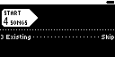

## TST.LIB.9.2.8
**Dir of Mixed New/Existing Files - Merge Existing** 
Import a directory of pre-existing audio files -- overwrite BPM and Key metadata of existing records with metadata from selected files

| PASS | FAIL | Build # | Timestamp | User |
| :---: | :---: | :--- | :--- | :--- |
| | | | | |

| Pass |          ID           | Action | Reference |
| :---: | :------------------- | --------: | :------- |
|  | TST.LIB.9.2.8.0 | Complete | [[TST.SET.2.2.1](../../SET/TST.SET.2_System#tst.set.2.2.1) Library DB Reset] |
|  | TST.LIB.9.2.8.1 | Complete | [[TST.LIB.9.2.1](TST.LIB.9.2.1_Dir_New.md) Dir of New Files] |
|  | TST.LIB.9.2.8.2 | Settings | <ul><li>UI/Library Menu/Show BPM = true</li><li>UI/Library Menu/Show Key = true</li></ul> |
|  | TST.LIB.9.2.8.3 | Navigate | Library/+Add Music/Browse Files  |
|  | TST.LIB.9.2.8.4 | File Browse | music/merge/dir_set_c/ |
|  | TST.LIB.9.2.8.5 | Verify |  [[Dir Import Options](../../../UI/LIB/UI.LIB.Library_Menu.md#ui.lib.9.0.0)] appears |
|  | TST.LIB.9.2.8.6 | Set |  [[Merge Setting](../../../UI/LIB/UI.LIB.Library_Menu.md#ui.lib.9.0.0.1)] = Merge |
|  | TST.LIB.9.2.8.7 | Set | ![[UI.LIB.X.X.X.1] BPM/Key Source](images/TST.LIB.9.2.7.7.bmp) <ul><li>[[BPM Source](../../../UI/LIB/UI.LIB.Library_Menu.md#UI.LIB.X.X.X.1)] = ID3 Tag</li><li>[[Key Source](../../../UI/LIB/UI.LIB.Library_Menu.md#UI.LIB.X.X.X.1)] = ID3 Tag</li></ul> |
|  | TST.LIB.9.2.8.8 | Select |  [[Dir Import Start Button](../../../UI/LIB/UI.LIB.Library_Menu.md#ui.lib.9.0.0.0)] |
|  | TST.LIB.9.2.8.9 | Navigate | Library/Artists |
|  | TST.LIB.9.2.8.10 | Verify | Menu Contents (all items appear only once):<ul><li>Zero QA Artist<ul><li>Cornell West (ODM Mix) [124 : Ab]</li><li>Kerri Chandler [61.5 : Bbm]</li><li>Magic [123 : F]</li><li>Outside the Veil [250 : Ebm]</li><li>Teacher [124 : Db]</li><li>The Legend of Pat Nice [123 : Am]</li><li>Water (ODM Mix) [124 : Ab]</li></ul></li></ul> | 

| Notes | 
| :--- |
|  |