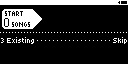
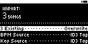
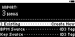
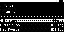
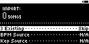
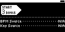

## TST.LIB.9.2.0
**Directory Import Options Menu** 
Cycle through all the UI permutations of merge settings and data sources to verify all options are available

| PASS | FAIL | Build # | Timestamp | User |
| :---: | :---: | :--- | :--- | :--- |
| | | | | |

| Pass |          ID           | Action | Reference |
| :---: | :------------------- | --------: | :------- |
|  | TST.LIB.9.2.0.0 | Complete | [[TST.SET.2.2.1](../../SET/TST.SET.2_System#tst.set.2.2.1) Library DB Reset] |
|  | TST.LIB.9.2.0.1 | Complete | [[TST.LIB.9.2.1](tst.lib.9.2.1) Dir of New Files] |
|  | TST.LIB.9.2.0.3 | Navigate | Library/+Add Music/Browse Files  |
|  | TST.LIB.9.2.0.4 | File Browse | music/merge/dir_set_b/ |
|  | TST.LIB.9.2.0.5 | Verify |  [[Dir Import Options](../../../UI/LIB/UI.LIB.Library_Menu.md#ui.lib.9.0.0)] appears |
|  | TST.LIB.9.2.0.6 | Set |  [[Merge Setting](../../../UI/LIB/UI.LIB.Library_Menu.md#ui.lib.9.0.0.1)] = Overwrite |
|  | TST.LIB.9.2.0.7 | Verify | <ul><li>[[BPM Source](../../../UI/LIB/UI.LIB.Library_Menu.md#UI.LIB.X.X.X.1)] = ID3 Tag</li><li>[[Key Source](../../../UI/LIB/UI.LIB.Library_Menu.md#UI.LIB.X.X.X.1)] = ID3 Tag</li></ul> |
|  | TST.LIB.9.2.0.8 | Set |  [[Merge Setting](../../../UI/LIB/UI.LIB.Library_Menu.md#ui.lib.9.0.0.1)] = Create New |
|  | TST.LIB.9.2.0.9 | Verify | <ul><li>[[BPM Source](../../../UI/LIB/UI.LIB.Library_Menu.md#UI.LIB.X.X.X.1)] = ID3 Tag</li><li>[[Key Source](../../../UI/LIB/UI.LIB.Library_Menu.md#UI.LIB.X.X.X.1)] = ID3 Tag</li></ul> |
|  | TST.LIB.9.2.0.10 | Set |  [[Merge Setting](../../../UI/LIB/UI.LIB.Library_Menu.md#ui.lib.9.0.0.1)] = Merge |
|  | TST.LIB.9.2.0.11 | Verify | <ul><li>[[BPM Source](../../../UI/LIB/UI.LIB.Library_Menu.md#UI.LIB.X.X.X.1)] = ID3 Tag</li><li>[[Key Source](../../../UI/LIB/UI.LIB.Library_Menu.md#UI.LIB.X.X.X.1)] = ID3 Tag</li></ul> |
|  | TST.LIB.9.2.0.12 | Set | <ul><li>[[BPM Source](../../../UI/LIB/UI.LIB.Library_Menu.md#UI.LIB.X.X.X.1)] = Library</li><li>[[Key Source](../../../UI/LIB/UI.LIB.Library_Menu.md#UI.LIB.X.X.X.1)] = Library</li></ul> |
|  | TST.LIB.9.2.0.13 | Set |  [[Merge Setting](../../../UI/LIB/UI.LIB.Library_Menu.md#ui.lib.9.0.0.1)] = Skip |
|  | TST.LIB.9.2.0.14 | Verify | <ul><li>[[BPM Source](../../../UI/LIB/UI.LIB.Library_Menu.md#UI.LIB.X.X.X.1)] = N/A</li><li>[[Key Source](../../../UI/LIB/UI.LIB.Library_Menu.md#UI.LIB.X.X.X.1)] = N/A</li></ul> |

| Notes | 
| :--- |
|  |

## TST.LIB.9.2.1
**Dir of New Files** 
Import a directory of audio files into an empty Library

| PASS | FAIL | Build # | Timestamp | User |
| :---: | :---: | :--- | :--- | :--- |
| | | | | |

| Pass |          ID           | Action | Reference |
| :---: | :------------------- | --------: | :------- |
|  | TST.LIB.9.2.1.0 | Complete | [[TST.SET.2.2.1](../../SET/TST.SET.2_System#tst.set.2.2.1) Library DB Reset] |
|  | TST.LIB.9.2.1.1 | Navigate | Library/+Add Music/Browse Files  |
|  | TST.LIB.9.2.1.2 | File Browse | music/merge/dir_set_a/ |
|  | TST.LIB.9.2.1.3 | Verify |  [[New Import Options](../../../UI/LIB/UI.LIB.Library_Menu.md#ui.lib.9.0.0)] appears |
|  | TST.LIB.9.2.1.4 | Select |  [[Dir Import Start Button](../../../UI/LIB/UI.LIB.Library_Menu.md#ui.lib.9.0.0.0)] |
|  | TST.LIB.9.2.1.5 | Navigate | Library/Artists |
|  | TST.LIB.9.2.1.6 | Verify | Menu Contents (all items appear only once):<ul><li>Zero QA Artist<ul><li>Cornell West (ODM Mix)</li><li>Kerri Chandler</li><li>Magic</li></ul></li></ul> | 

| Notes | 
| :--- |
|  |

## TST.LIB.9.2.2
**Dir of Existing Files - Skip** 
Import a directory of pre-existing audio files -- skip existing files

| PASS | FAIL | Build # | Timestamp | User |
| :---: | :---: | :--- | :--- | :--- |
| | | | | |

| Pass |          ID           | Action | Reference |
| :---: | :------------------- | --------: | :------- |
|  | TST.LIB.9.2.2.0 | Complete | [[TST.SET.2.2.1](../../SET/TST.SET.2_System#tst.set.2.2.1) Library DB Reset] |
|  | TST.LIB.9.2.2.1 | Complete | [[TST.LIB.9.2.1](tst.lib.9.2.1) Dir of New Files] |
|  | TST.LIB.9.2.2.2 | Settings | <ul><li>UI/Library Menu/Show BPM = true</li><li>UI/Library Menu/Show Key = true</li></ul> |
|  | TST.LIB.9.2.2.3 | Navigate | Library/+Add Music/Browse Files  |
|  | TST.LIB.9.2.2.4 | File Browse | music/merge/dir_set_b/ |
|  | TST.LIB.9.2.2.5 | Verify |  [[Dir Import Options](../../../UI/LIB/UI.LIB.Library_Menu.md#ui.lib.9.0.0)] appears |
|  | TST.LIB.9.2.2.6 | Select |  [[Dir Import Start Button](../../../UI/LIB/UI.LIB.Library_Menu.md#ui.lib.9.0.0.0)] |
|  | TST.LIB.9.2.2.7 | Navigate | Library/Artists |
|  | TST.LIB.9.2.2.8 | Verify | Menu Contents (all items appear only once):<ul><li>Zero QA Artist<ul><li>Cornell West (ODM Mix) [126.2 : Bb]</li><li>Kerri Chandler [122 : Fm]</li><li>Magic [125 : C]</li></ul></li></ul> | 

| Notes | 
| :--- |
|  |

## TST.LIB.9.2.3
**Dir of Existing Files - Overwrite** 
Import a directory of pre-existing audio files -- overwrite metadata of existing files

| PASS | FAIL | Build # | Timestamp | User |
| :---: | :---: | :--- | :--- | :--- |
| | | | | |

| Pass |          ID           | Action | Reference |
| :---: | :------------------- | --------: | :------- |
|  | TST.LIB.9.2.3.0 | Complete | [[TST.SET.2.2.1](../../SET/TST.SET.2_System#tst.set.2.2.1) Library DB Reset] |
|  | TST.LIB.9.2.3.1 | Complete | [[TST.LIB.9.2.1](tst.lib.9.2.1) Dir of New Files] |
|  | TST.LIB.9.2.3.2 | Settings | <ul><li>UI/Library Menu/Show BPM = true</li><li>UI/Library Menu/Show Key = true</li></ul> |
|  | TST.LIB.9.2.3.3 | Navigate | Library/+Add Music/Browse Files  |
|  | TST.LIB.9.2.3.4 | File Browse | music/merge/dir_set_b/ |
|  | TST.LIB.9.2.3.5 | Verify |  [[Dir Import Options](../../../UI/LIB/UI.LIB.Library_Menu.md#ui.lib.9.0.0)] appears |
|  | TST.LIB.9.2.3.6 | Set |  [[Merge Setting](../../../UI/LIB/UI.LIB.Library_Menu.md#ui.lib.9.0.0.1)] = Overwrite |
|  | TST.LIB.9.2.3.7 | Select |  [[Dir Import Start Button](../../../UI/LIB/UI.LIB.Library_Menu.md#ui.lib.9.0.0.0)] |
|  | TST.LIB.9.2.3.8 | Navigate | Library/Artists |
|  | TST.LIB.9.2.3.9 | Verify | Menu Contents (all items appear only once):<ul><li>Zero QA Artist<ul><li>Cornell West (ODM Mix) [124 : Ab]</li><li>Kerri Chandler [61.5 : Bbm]</li><li>Magic [123 : F]</li></ul></li></ul> | 

| Notes | 
| :--- |
|  |

## TST.LIB.9.2.4
**Dir of Existing Files - Create New** 
Import a directory of pre-existing audio files -- create duplicate records for exsiting songs

| Pass |          ID           | Action | Reference |
| :---: | :------------------- | --------: | :------- |
|  | TST.LIB.9.2.4.0 | Complete | [[TST.SET.2.2.1](../../SET/TST.SET.2_System#tst.set.2.2.1) Library DB Reset] |
|  | TST.LIB.9.2.4.1 | Complete | [[TST.LIB.9.2.1](tst.lib.9.2.1) Dir of New Files] |
|  | TST.LIB.9.2.4.2 | Settings | <ul><li>UI/Library Menu/Show BPM = true</li><li>UI/Library Menu/Show Key = true</li></ul> |
|  | TST.LIB.9.2.4.3 | Navigate | Library/+Add Music/Browse Files  |
|  | TST.LIB.9.2.4.4 | File Browse | music/merge/dir_set_b/ |
|  | TST.LIB.9.2.4.5 | Verify |  [[Dir Import Options](../../../UI/LIB/UI.LIB.Library_Menu.md#ui.lib.9.0.0)] appears |
|  | TST.LIB.9.2.4.6 | Set |  [[Merge Setting](../../../UI/LIB/UI.LIB.Library_Menu.md#ui.lib.9.0.0.1)] = Create New |
|  | TST.LIB.9.2.4.7 | Select |  [[Dir Import Start Button](../../../UI/LIB/UI.LIB.Library_Menu.md#ui.lib.9.0.0.0)] |
|  | TST.LIB.9.2.4.8 | Navigate | Library/Artists |
|  | TST.LIB.9.2.4.9 | Verify | Menu Contents (all items appear only once):<ul><li>Zero QA Artist<ul><li>Cornell West (ODM Mix) [124 : Ab]</li><li>Cornell West (ODM Mix) [126.2 : Bb]</li><li>Kerri Chandler [61.5 : Bbm]</li><li>Kerri Chandler [122 : Fm]</li><li>Magic [123 : F]</li><li>Magic [125 : C]</li></ul></li></ul> | 

| Notes | 
| :--- |
|  |

## TST.LIB.9.2.5
**Dir of Existing Files - Merge - ID3 Tag** 
Import a directory of pre-existing audio files -- overwrite BPM and Key metadata of existing records with metadata from selected files

| Pass |          ID           | Action | Reference |
| :---: | :------------------- | --------: | :------- |
|  | TST.LIB.9.2.5.0 | Complete | [[TST.SET.2.2.1](../../SET/TST.SET.2_System#tst.set.2.2.1) Library DB Reset] |
|  | TST.LIB.9.2.5.1 | Complete | [[TST.LIB.9.2.1](tst.lib.9.2.1) Dir of New Files] |
|  | TST.LIB.9.2.5.2 | Settings | <ul><li>UI/Library Menu/Show BPM = true</li><li>UI/Library Menu/Show Key = true</li></ul> |
|  | TST.LIB.9.2.5.3 | Navigate | Library/+Add Music/Browse Files  |
|  | TST.LIB.9.2.5.4 | File Browse | music/merge/dir_set_b/ |
|  | TST.LIB.9.2.5.5 | Verify |  [[Dir Import Options](../../../UI/LIB/UI.LIB.Library_Menu.md#ui.lib.9.0.0)] appears |
|  | TST.LIB.9.2.5.6 | Set |  [[Merge Setting](../../../UI/LIB/UI.LIB.Library_Menu.md#ui.lib.9.0.0.1)] = Merge |
|  | TST.LIB.9.2.5.7 | Set | ![[UI.LIB.X.X.X.1] BPM/Key Source](images/TST.LIB.9.2.4.6.bmp) <ul><li>[[BPM Source](../../../UI/LIB/UI.LIB.Library_Menu.md#UI.LIB.X.X.X.1)] = ID3 Tag</li><li>[[Key Source](../../../UI/LIB/UI.LIB.Library_Menu.md#UI.LIB.X.X.X.1)] = ID3 Tag</li></ul> |
|  | TST.LIB.9.2.5.8 | Select |  [[Dir Import Start Button](../../../UI/LIB/UI.LIB.Library_Menu.md#ui.lib.9.0.0.0)] |
|  | TST.LIB.9.2.5.9 | Navigate | Library/Artists |
|  | TST.LIB.9.2.5.10 | Verify | Menu Contents (all items appear only once):<ul><li>Zero QA Artist<ul><li>Cornell West (ODM Mix) [124 : Ab]</li><li>Kerri Chandler [61.5 : Bbm]</li><li>Magic [123 : F]</li></ul></li></ul> | 

| Notes | 
| :--- |
|  |

## TST.LIB.9.2.6
**Dir of Existing Files - Merge - Library** 
Import a directory of pre-existing audio files -- retain existing BPM and Key metadata in Library

| Pass |          ID           | Action | Reference |
| :---: | :------------------- | --------: | :------- |
|  | TST.LIB.9.2.6.0 | Complete | [[TST.SET.2.2.1](../../SET/TST.SET.2_System#tst.set.2.2.1) Library DB Reset] |
|  | TST.LIB.9.2.6.1 | Complete | [[TST.LIB.9.2.1](tst.lib.9.2.1) Dir of New Files] |
|  | TST.LIB.9.2.6.2 | Settings | <ul><li>UI/Library Menu/Show BPM = true</li><li>UI/Library Menu/Show Key = true</li></ul> |
|  | TST.LIB.9.2.6.3 | Navigate | Library/+Add Music/Browse Files  |
|  | TST.LIB.9.2.6.4 | File Browse | music/merge/dir_set_b/ |
|  | TST.LIB.9.2.6.5 | Verify |  [[Dir Import Options](../../../UI/LIB/UI.LIB.Library_Menu.md#ui.lib.9.0.0)] appears |
|  | TST.LIB.9.2.6.6 | Set |  [[Merge Setting](../../../UI/LIB/UI.LIB.Library_Menu.md#ui.lib.9.0.0.1)] = Merge |
|  | TST.LIB.9.0.5.7 | Set | ![[UI.LIB.X.X.X.1] BPM/Key Source](images/TST.LIB.9.2.5.6.bmp) <ul><li>[[BPM Source](../../../UI/LIB/UI.LIB.Library_Menu.md#UI.LIB.X.X.X.1)] = Library</li><li>[[Key Source](../../../UI/LIB/UI.LIB.Library_Menu.md#UI.LIB.X.X.X.1)] = Library</li></ul> |
|  | TST.LIB.9.2.6.8 | Select |  [[Dir Import Start Button](../../../UI/LIB/UI.LIB.Library_Menu.md#ui.lib.9.0.0.0)] |
|  | TST.LIB.9.2.6.9 | Navigate | Library/Artists |
|  | TST.LIB.9.2.6.10 | Verify | Menu Contents (all items appear only once):<ul><li>Zero QA Artist<ul><li>Cornell West (ODM Mix) [126.2 : Bb]</li><li>Kerri Chandler [122 : Fm]</li><li>Magic [125 : C]</li></ul></li></ul> | 

| Notes | 
| :--- |
|  |

## TST.LIB.9.2.7
**Dir of Mixed New/Existing Files - Skip Existing** 
Import a directory of pre-existing audio files -- skip existing files

| PASS | FAIL | Build # | Timestamp | User |
| :---: | :---: | :--- | :--- | :--- |
| | | | | |

| Pass |          ID           | Action | Reference |
| :---: | :------------------- | --------: | :------- |
|  | TST.LIB.9.2.7.0 | Complete | [[TST.SET.2.2.1](../../SET/TST.SET.2_System#tst.set.2.2.1) Library DB Reset] |
|  | TST.LIB.9.2.7.1 | Complete | [[TST.LIB.9.2.1](tst.lib.9.2.1) Dir of New Files] |
|  | TST.LIB.9.2.7.2 | Settings | <ul><li>UI/Library Menu/Show BPM = true</li><li>UI/Library Menu/Show Key = true</li></ul> |
|  | TST.LIB.9.2.7.3 | Navigate | Library/+Add Music/Browse Files  |
|  | TST.LIB.9.2.7.4 | File Browse | music/merge/dir_set_c/ |
|  | TST.LIB.9.2.7.5 | Verify |  [[Dir Import Options](../../../UI/LIB/UI.LIB.Library_Menu.md#ui.lib.9.0.0)] appears |
|  | TST.LIB.9.2.7.6 | Select |  [[Dir Import Start Button](../../../UI/LIB/UI.LIB.Library_Menu.md#ui.lib.9.0.0.0)] |
|  | TST.LIB.9.2.7.7 | Navigate | Library/Artists |
|  | TST.LIB.9.2.7.8 | Verify | Menu Contents (all items appear only once):<ul><li>Zero QA Artist<ul><li>Cornell West (ODM Mix) [126.2 : Bb]</li><li>Kerri Chandler [122 : Fm]</li><li>Magic [125 : C]</li><li>Outside the Veil [250 : Ebm]</li><li>Teacher [124 : Db]</li><li>The Legend of Pat Nice [123 : Am]</li><li>Water (ODM Mix) [124 : Ab]</li></ul></li></ul> | 

| Notes | 
| :--- |
|  |

## TST.LIB.9.2.8
**Dir of Mixed New/Existing Files - Merge Existing** 
Import a directory of pre-existing audio files -- overwrite BPM and Key metadata of existing records with metadata from selected files

| PASS | FAIL | Build # | Timestamp | User |
| :---: | :---: | :--- | :--- | :--- |
| | | | | |

| Pass |          ID           | Action | Reference |
| :---: | :------------------- | --------: | :------- |
|  | TST.LIB.9.2.8.0 | Complete | [[TST.SET.2.2.1](../../SET/TST.SET.2_System#tst.set.2.2.1) Library DB Reset] |
|  | TST.LIB.9.2.8.1 | Complete | [[TST.LIB.9.2.1](tst.lib.9.2.1) Dir of New Files] |
|  | TST.LIB.9.2.8.2 | Settings | <ul><li>UI/Library Menu/Show BPM = true</li><li>UI/Library Menu/Show Key = true</li></ul> |
|  | TST.LIB.9.2.8.3 | Navigate | Library/+Add Music/Browse Files  |
|  | TST.LIB.9.2.8.4 | File Browse | music/merge/dir_set_c/ |
|  | TST.LIB.9.2.8.5 | Verify |  [[Dir Import Options](../../../UI/LIB/UI.LIB.Library_Menu.md#ui.lib.9.0.0)] appears |
|  | TST.LIB.9.2.8.6 | Set |  [[Merge Setting](../../../UI/LIB/UI.LIB.Library_Menu.md#ui.lib.9.0.0.1)] = Merge |
|  | TST.LIB.9.2.8.7 | Set | ![[UI.LIB.X.X.X.1] BPM/Key Source](images/TST.LIB.9.2.7.7.bmp) <ul><li>[[BPM Source](../../../UI/LIB/UI.LIB.Library_Menu.md#UI.LIB.X.X.X.1)] = ID3 Tag</li><li>[[Key Source](../../../UI/LIB/UI.LIB.Library_Menu.md#UI.LIB.X.X.X.1)] = ID3 Tag</li></ul> |
|  | TST.LIB.9.2.8.8 | Select |  [[Dir Import Start Button](../../../UI/LIB/UI.LIB.Library_Menu.md#ui.lib.9.0.0.0)] |
|  | TST.LIB.9.2.8.9 | Navigate | Library/Artists |
|  | TST.LIB.9.2.8.10 | Verify | Menu Contents (all items appear only once):<ul><li>Zero QA Artist<ul><li>Cornell West (ODM Mix) [124 : Ab]</li><li>Kerri Chandler [61.5 : Bbm]</li><li>Magic [123 : F]</li><li>Outside the Veil [250 : Ebm]</li><li>Teacher [124 : Db]</li><li>The Legend of Pat Nice [123 : Am]</li><li>Water (ODM Mix) [124 : Ab]</li></ul></li></ul> | 

| Notes | 
| :--- |
|  |

✅ ❌