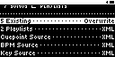
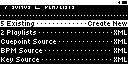
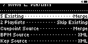
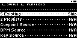

## TST.LIB.9.4.0
**Rekordbox XML Import Options Menu** 
Cycle through all the UI permutations of merge settings and data sources to verify all options are available

| PASS | FAIL | Build # | Timestamp | User |
| :---: | :---: | :--- | :--- | :--- |
| | | | | |

| Pass |          ID           | Action | Reference |
| :---: | :------------------- | :-------- | :------- |
|  | TST.LIB.9.4.0.0 | Complete: | [[TST.SET.2.2.1](../../SET/TST.SET.2_System#tst.set.2.2.1) Library DB Reset] |
|  | TST.LIB.9.4.0.1 | Complete: | [[TST.FS.X](../../SET/TST.SET.2_System#tst.set.2.2.1) Configure QA Filesystem - Copy via Rekordbox UI] |
|  | TST.LIB.9.4.0.2 | Complete: | [[TST.LIB.9.4.1](../../SET/TST.SET.2_System#tst.set.2.2.1) New Rekordbox XML] |
|  | TST.LIB.9.4.0.3 | Navigate: | Library/+Add Music/Rekordbox XML  |
|  | TST.LIB.9.4.0.4 | Verify: | ![[UI.LIB.9.0.0] New](images/TST.LIB.9.4.1.3.bmp) [[Select RB XML](../../../UI/LIB/UI.LIB.Library_Menu.md#ui.lib.9.0.0)] appears |
|  | TST.LIB.9.4.0.5 | Select: | ![[UI.LIB.9.0.0.0] Okay](images/TST.LIB.9.4.0.3.bmp) [[Okay](../../../UI/LIB/UI.LIB.Library_Menu.md#ui.lib.9.0.0.0)] |
|  | TST.LIB.9.4.0.6 | File Browse: | music/merge/rb_xml/rb_xml_b.xml |
|  | TST.LIB.9.4.0.7 | Verify: | ![[UI.LIB.9.0.0] New](images/TST.LIB.9.4.1.7.bmp) [[Select RB Scan Dir](../../../UI/LIB/UI.LIB.Library_Menu.md#ui.lib.9.0.0)] appears |
|  | TST.LIB.9.4.0.8 | Select: | ![[UI.LIB.9.0.0.0] Okay](images/TST.LIB.9.4.0.3.bmp) [[Okay](../../../UI/LIB/UI.LIB.Library_Menu.md#ui.lib.9.0.0.0)] |
|  | TST.LIB.9.4.0.9 | File Browse: | Contents/ |
|  | TST.LIB.9.4.0.10 | Verify: | ![[UI.LIB.9.0.0] New](images/TST.LIB.9.4.0.10.bmp) [[XML Import Options](../../../UI/LIB/UI.LIB.Library_Menu.md#ui.lib.9.0.0)] appears |
|  | TST.LIB.9.4.0.11 | Set: |  [[Merge Setting](../../../UI/LIB/UI.LIB.Library_Menu.md#ui.lib.9.0.0.1)] = Overwrite |
|  | TST.LIB.9.4.0.12 | Verify: | <ul><li>[[2 Playlists](../../../UI/LIB/UI.LIB.Library_Menu.md#UI.LIB.X.X.X.1)] = XML</li><li>[[Cuepoint Source](../../../UI/LIB/UI.LIB.Library_Menu.md#UI.LIB.X.X.X.1)] = XML</li><li>[[BPM Source](../../../UI/LIB/UI.LIB.Library_Menu.md#UI.LIB.X.X.X.1)] = XML</li><li>[[Key Source](../../../UI/LIB/UI.LIB.Library_Menu.md#UI.LIB.X.X.X.1)] = XML</li></ul> |
|  | TST.LIB.9.4.0.13 | Set: |  [[Merge Setting](../../../UI/LIB/UI.LIB.Library_Menu.md#ui.lib.9.0.0.1)] = Create New |
|  | TST.LIB.9.4.0.14 | Verify: | <ul><li>[[2 Playlists](../../../UI/LIB/UI.LIB.Library_Menu.md#UI.LIB.X.X.X.1)] = XML</li><li>[[Cuepoint Source](../../../UI/LIB/UI.LIB.Library_Menu.md#UI.LIB.X.X.X.1)] = XML</li><li>[[BPM Source](../../../UI/LIB/UI.LIB.Library_Menu.md#UI.LIB.X.X.X.1)] = XML</li><li>[[Key Source](../../../UI/LIB/UI.LIB.Library_Menu.md#UI.LIB.X.X.X.1)] = XML</li></ul> |
|  | TST.LIB.9.4.0.15 | Set: |  [[Merge Setting](../../../UI/LIB/UI.LIB.Library_Menu.md#ui.lib.9.0.0.1)] = Merge |
|  | TST.LIB.9.4.0.16 | Verify: | <ul><li>[[2 Playlists](../../../UI/LIB/UI.LIB.Library_Menu.md#UI.LIB.X.X.X.1)] = Skip Existing</li><li>[[Cuepoint Source](../../../UI/LIB/UI.LIB.Library_Menu.md#UI.LIB.X.X.X.1)] = Merge</li><li>[[BPM Source](../../../UI/LIB/UI.LIB.Library_Menu.md#UI.LIB.X.X.X.1)] = XML</li><li>[[Key Source](../../../UI/LIB/UI.LIB.Library_Menu.md#UI.LIB.X.X.X.1)] = XML</li></ul> |
|  | TST.LIB.9.4.0.17 | Set: |  [[Merge Setting](../../../UI/LIB/UI.LIB.Library_Menu.md#ui.lib.9.0.0.1)] = Skip |
|  | TST.LIB.9.4.0.18 | Verify: | <ul><li>[[2 Playlists](../../../UI/LIB/UI.LIB.Library_Menu.md#UI.LIB.X.X.X.1)] = N/A</li><li>[[Cuepoint Source](../../../UI/LIB/UI.LIB.Library_Menu.md#UI.LIB.X.X.X.1)] = N/A</li><li>[[BPM Source](../../../UI/LIB/UI.LIB.Library_Menu.md#UI.LIB.X.X.X.1)] = N/A</li><li>[[Key Source](../../../UI/LIB/UI.LIB.Library_Menu.md#UI.LIB.X.X.X.1)] = N/A</li></ul> |

| Notes | 
| :--- |
|  |

## TST.LIB.9.4.1
**New Rekordbox XML** 
Import a Rekordbox XML into an empty Library

| PASS | FAIL | Build # | Timestamp | User |
| :---: | :---: | :--- | :--- | :--- |
| | | | | |

| Pass |          ID           | Action | Reference |
| :---: | :------------------- | :-------- | :------- |
|  | TST.LIB.9.4.1.0 | Complete: | [[TST.SET.2.2.1](../../SET/TST.SET.2_System#tst.set.2.2.1) Library DB Reset] |
|  | TST.LIB.9.4.1.1 | Complete: | [[TST.FS.X](../../SET/TST.SET.2_System#tst.set.2.2.1) Configure QA Filesystem - Copy via Rekordbox UI] |
|  | TST.LIB.9.4.1.2 | Navigate: | Library/+Add Music/Rekordbox XML  |
|  | TST.LIB.9.4.1.3 | Verify: | ![[UI.LIB.9.0.0] New](images/TST.LIB.9.4.1.3.bmp) [[Select RB XML](../../../UI/LIB/UI.LIB.Library_Menu.md#ui.lib.9.0.0)] appears |
|  | TST.LIB.9.4.1.4 | Select: | ![[UI.LIB.9.0.0.0] Okay](images/TST.LIB.9.4.0.3.bmp) [[Okay](../../../UI/LIB/UI.LIB.Library_Menu.md#ui.lib.9.0.0.0)] |
|  | TST.LIB.9.4.1.5 | File Browse: | music/merge/rb_xml/rb_xml_a.xml |
|  | TST.LIB.9.4.1.6 | Verify: | ![[UI.LIB.9.0.0] New](images/TST.LIB.9.4.1.7.bmp) [[Select RB Scan Dir](../../../UI/LIB/UI.LIB.Library_Menu.md#ui.lib.9.0.0)] appears |
|  | TST.LIB.9.4.1.7 | Select: | ![[UI.LIB.9.0.0.0] Okay](images/TST.LIB.9.4.0.3.bmp) [[Okay](../../../UI/LIB/UI.LIB.Library_Menu.md#ui.lib.9.0.0.0)] |
|  | TST.LIB.9.4.1.8 | File Browse: | Contents/ |
|  | TST.LIB.9.4.1.9 | Verify: | ![[UI.LIB.9.0.0] New](images/TST.LIB.9.4.1.9.bmp) [[XML Import Options](../../../UI/LIB/UI.LIB.Library_Menu.md#ui.lib.9.0.0)] appears |
|  | TST.LIB.9.4.1.10 | Select: | ![[UI.LIB.9.0.0.0] New](images/TST.LIB.9.4.1.10.bmp) [[Start Button](../../../UI/LIB/UI.LIB.Library_Menu.md#ui.lib.9.0.0.0)] |
|  | TST.LIB.9.4.1.11 | Navigate: | Library/Artists |
|  | TST.LIB.9.4.1.12 | Verify: | Menu Contents (all items appear only once):<ul><li>Zero QA Artist<ul><li>Cornell West (ODM Mix)</li><li>Kerri Chandler</li><li>Outside the Veil</li><li>The Legend of Pat Nice</li><li>Water (ODM Mix)</li></ul></li></ul> | 

| Notes | 
| :--- |
|  |

## TST.LIB.9.4.2
**Existing Rekordbox XML - Skip** 
Import a Rekordbox XML of pre-existing audio files -- skip existing files

| PASS | FAIL | Build # | Timestamp | User |
| :---: | :---: | :--- | :--- | :--- |
| | | | | |

| Pass |          ID           | Action | Reference |
| :---: | :------------------- | :-------- | :------- |
|  | TST.LIB.9.4.2.0 | Complete: | [[TST.SET.2.2.1](../../SET/TST.SET.2_System#tst.set.2.2.1) Library DB Reset] |
|  | TST.LIB.9.4.2.1 | Complete: | [[TST.FS.X](../../SET/TST.SET.2_System#tst.set.2.2.1) Configure QA Filesystem - Copy via Rekordbox UI] |
|  | TST.LIB.9.4.2.2 | Navigate: | Library/+Add Music/Rekordbox XML  |
|  | TST.LIB.9.4.2.3 | Verify: | ![[UI.LIB.9.0.0] New](images/TST.LIB.9.4.1.3.bmp) [[Select RB XML](../../../UI/LIB/UI.LIB.Library_Menu.md#ui.lib.9.0.0)] appears |
|  | TST.LIB.9.4.2.4 | Select: | ![[UI.LIB.9.0.0.0] Okay](images/TST.LIB.9.4.0.3.bmp) [[Okay](../../../UI/LIB/UI.LIB.Library_Menu.md#ui.lib.9.0.0.0)] |
|  | TST.LIB.9.4.2.5 | File Browse: | music/merge/rb_xml/rb_xml_a.xml |
|  | TST.LIB.9.4.2.6 | Verify: | ![[UI.LIB.9.0.0] New](images/TST.LIB.9.4.1.7.bmp) [[Select RB Scan Dir](../../../UI/LIB/UI.LIB.Library_Menu.md#ui.lib.9.0.0)] appears |
|  | TST.LIB.9.4.2.7 | Select: | ![[UI.LIB.9.0.0.0] Okay](images/TST.LIB.9.4.0.3.bmp) [[Okay](../../../UI/LIB/UI.LIB.Library_Menu.md#ui.lib.9.0.0.0)] |
|  | TST.LIB.9.4.2.8 | File Browse: | Contents/ |
|  | TST.LIB.9.4.2.9 | Verify: | ![[UI.LIB.9.0.0] New](images/TST.LIB.9.4.2.9.bmp) [[XML Import Options](../../../UI/LIB/UI.LIB.Library_Menu.md#ui.lib.9.0.0)] appears |
|  | TST.LIB.9.4.2.10 | Select: | ![[UI.LIB.9.0.0.0] New](images/TST.LIB.9.4.2.10.bmp) [[Start Button](../../../UI/LIB/UI.LIB.Library_Menu.md#ui.lib.9.0.0.0)] |
|  | TST.LIB.9.4.2.11 | Navigate: | Library/Artists |
|  | TST.LIB.9.4.2.12 | Verify: | Menu Contents (all items appear only once):<ul><li>Zero QA Artist<ul><li>Cornell West (ODM Mix)</li><li>Kerri Chandler</li><li>Outside the Veil</li><li>The Legend of Pat Nice</li><li>Water (ODM Mix)</li></ul></li></ul> | 

| Notes | 
| :--- |
|  |

## TST.LIB.9.4.3
**Mixed New/Existing Rekordbox XML - Merge** 
Import a Rekordbox XML of pre-existing audio files -- merge existing files

| PASS | FAIL | Build # | Timestamp | User |
| :---: | :---: | :--- | :--- | :--- |
| | | | | |

| Pass |          ID           | Action | Reference |
| :---: | :------------------- | :-------- | :------- |
|  | TST.LIB.9.4.2.0 | Complete: | [[TST.SET.2.2.1](../../SET/TST.SET.2_System#tst.set.2.2.1) Library DB Reset] |
|  | TST.LIB.9.4.2.1 | Complete: | [[TST.FS.X](../../SET/TST.SET.2_System#tst.set.2.2.1) Configure QA Filesystem - Copy via Rekordbox UI] |
|  | TST.LIB.9.4.2.2 | Navigate: | Library/+Add Music/Rekordbox XML  |
|  | TST.LIB.9.4.2.3 | Verify: | ![[UI.LIB.9.0.0] New](images/TST.LIB.9.4.1.3.bmp) [[Select RB XML](../../../UI/LIB/UI.LIB.Library_Menu.md#ui.lib.9.0.0)] appears |
|  | TST.LIB.9.4.2.4 | Select: | ![[UI.LIB.9.0.0.0] Okay](images/TST.LIB.9.4.0.3.bmp) [[Okay](../../../UI/LIB/UI.LIB.Library_Menu.md#ui.lib.9.0.0.0)] |
|  | TST.LIB.9.4.2.5 | File Browse: | music/merge/rb_xml/rb_xml_b.xml |
|  | TST.LIB.9.4.2.6 | Verify: | ![[UI.LIB.9.0.0] New](images/TST.LIB.9.4.1.7.bmp) [[Select RB Scan Dir](../../../UI/LIB/UI.LIB.Library_Menu.md#ui.lib.9.0.0)] appears |
|  | TST.LIB.9.4.2.7 | Select: | ![[UI.LIB.9.0.0.0] Okay](images/TST.LIB.9.4.0.3.bmp) [[Okay](../../../UI/LIB/UI.LIB.Library_Menu.md#ui.lib.9.0.0.0)] |
|  | TST.LIB.9.4.2.8 | File Browse: | Contents/ |
|  | TST.LIB.9.4.2.9 | Verify: | ![[UI.LIB.9.0.0] New](images/TST.LIB.9.4.2.9.bmp) [[XML Import Options](../../../UI/LIB/UI.LIB.Library_Menu.md#ui.lib.9.0.0)] appears |
|  | TST.LIB.9.4.2.10 | Select: | ![[UI.LIB.9.0.0.0] New](images/TST.LIB.9.4.2.10.bmp) [[Start Button](../../../UI/LIB/UI.LIB.Library_Menu.md#ui.lib.9.0.0.0)] |
|  | TST.LIB.9.4.2.11 | Navigate: | Library/Artists |
|  | TST.LIB.9.4.2.12 | Verify: | Menu Contents (all items appear only once):<ul><li>Zero QA Artist<ul><li>Cornell West (ODM Mix)</li><li>Kerri Chandler</li><li>Outside the Veil</li><li>The Legend of Pat Nice</li><li>Water (ODM Mix)</li></ul></li></ul> | 

| Notes | 
| :--- |
|  |

✅ ❌