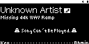
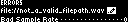
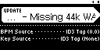
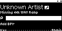
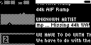

## TST.LIB.9.6.0
**Fix Song Error**

| PASS | FAIL | Build # | Timestamp | User |
| :--: | :--: | :------ | :-------- | :--- |
|  ✅   |      |         |           |      |

| Pass | ID               |      Action | Reference                                                                                 |
| :--: | :--------------- | ----------: | :---------------------------------------------------------------------------------------- |
|  ✅   | TST.LIB.9.6.0.0  |   Configure | [[CONF.LIB.2](../../../CONF/LIB/CONF.LIB.2_Error_QA_Lib.md) Install QA Lib: Error Files]  |
|  ✅   | TST.LIB.9.6.0.1  |    Settings | UI/Hide Unplayable Songs = false                                                          |
|  ✅   | TST.LIB.9.6.0.2  |    Navigate | Library/Artists/Unknown Artist/Missing 44k WAV Ramp/Song Edit                             |
|  ✅   | TST.LIB.9.6.0.3  |      Verify |  [[Song Error](xxx.md)] appears          |
|  ✅   | TST.LIB.9.6.0.4  |      Select |  [[Filepath edit](xxx.md)]                 |
|  ✅   | TST.LIB.9.6.0.5  | File Browse | music/format/wav/ramp_st_44_f32_t0.wav                                                    |
|  ✅   | TST.LIB.9.6.0.6  |      Verify |  [[Rescan dialog](xxx.md)] appears                |
|  ✅   | TST.LIB.9.6.0.7  |      Select | Okay                                                   |
|  ✅   | TST.LIB.9.6.0.8  |      Verify |  [[Import](xxx.md)] appears                       |
|  ✅   | TST.LIB.9.6.0.9  |      Select | Start                                                 |
|  ✅   | TST.LIB.9.6.0.10 |      Verify |  Song Edit appears (without error)   |
|  ✅   | TST.LIB.9.6.0.11 |    Navigate | Library/Artists/Unknown Artist/Missiing 44k WAV Ramp                                      |
|  ⚠️  | TST.LIB.9.6.0.12 |      Verify |  Menu item Error flag doesn't appear |
|  ✅   | TST.LIB.9.6.0.13 | Load Deck 1 | Unknown Artist/Missing 44k WAV Ramp                                                       |
|  ✅   | TST.LIB.9.6.0.14 |      Verify | Deck 1 loads and playback functions                                                       |

| Notes | 
| :--- |
|  |