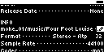
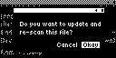
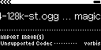

## TST.LIB.9.6.2
**Rescan Codec Error**

| PASS | FAIL | Build # | Timestamp | User |
| :--: | :--: | :------ | :-------- | :--- |
|  ✅   |      |         |           |      |

| Pass | ID              |      Action | Reference                                                                                       |
| :--: | :-------------- | ----------: | :---------------------------------------------------------------------------------------------- |
|  ✅   | TST.LIB.9.6.2.0 |   Configure | [[CONF.LIB.2](../../../CONF/LIB/CONF.LIB.1_Simple_QA_Lib.md) Install QA Lib: Simple Files]      |
|  ✅   | TST.LIB.9.6.2.1 |    Navigate | Library/Artists/Four Foot Louise/Magic/Song Edit                                                |
|  ✅   | TST.LIB.9.6.2.2 |      Select |  [[Filepath edit](xxx.md)]                       |
|  ✅   | TST.LIB.9.6.2.3 | File Browse | music/format/ogg/magic-44-128k-st.ogg                                                           |
|  ✅   | TST.LIB.9.6.2.4 |      Verify |  [[Rescan dialog](xxx.md)] appears                      |
|  ✅   | TST.LIB.9.6.2.5 |      Select | Okay                                                         |
|  ✅   | TST.LIB.9.6.2.6 |      Verify |  [[Unsupported Codec Error](xxx.md)] appears |

| Notes | 
| :--- |
|  |