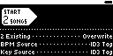

## TST.LIB.9.6.4
**Long ID3 Tags**

| PASS | FAIL | Build # | Timestamp | User |
| :---: | :---: | :--- | :--- | :--- |
| | | | | |

| Pass |          ID           | Action | Reference |
| :---: | :------------------- | --------: | :------- |
|  | TST.LIB.9.6.4.0 | Configure | [[CONF.LIB.2](../../../CONF/LIB/CONF.LIB.2_Error_QA_Lib.md) Install QA Lib: Error Files] |
|  | TST.LIB.9.0.2.1 | Settings | <ul><li>UI/Hide Unplayable Songs = false</li></ul> |
|  | TST.LIB.9.6.4.1 | Navigate | Library/Artists/We Have To Do With.../We Have To Do With... |
|  | TST.LIB.9.6.4.2 | Verify |  Song Edit appears (without error) |
|  | TST.LIB.9.6.4.3 | Navigate | Library/+Add Music/Browse Files  |
|  | TST.LIB.9.6.4.4 | File Browse | music/tag/t6/ |
|  | TST.LIB.9.6.4.5 | Verify |  [[Dir Import Options](../../../UI/LIB/UI.LIB.Library_Menu.md#ui.lib.9.0.0)] appears |
|  | TST.LIB.9.6.4.6 | Set |  [[Merge Setting](../../../UI/LIB/UI.LIB.Library_Menu.md#ui.lib.9.0.0.1)] = Overwrite |
|  | TST.LIB.9.6.4.7 | Select |  [[Dir Import Start Button](../../../UI/LIB/UI.LIB.Library_Menu.md#ui.lib.9.0.0.0)] |
|  | TST.LIB.9.6.4.8 | Navigate | Library/Artists |
|  | TST.LIB.9.6.4.9 | Verify |  [T6 - 1...] and [T6 - 2...] appear without error |

| Notes | 
| :--- |
|  |