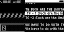
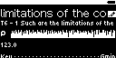
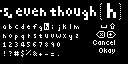
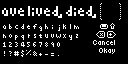

## TST.LIB.9.6.5
**Long Rekordbox Strings**

| PASS | FAIL | Build # | Timestamp | User |
| :---: | :---: | :--- | :--- | :--- |
| | | | | |

| Pass |          ID           | Action | Reference |
| :---: | :------------------- | --------: | :------- |
|  | TST.LIB.9.6.5.0 | Complete | [[TST.SET.2.2.1](../../SET/TST.SET.2_System#tst.set.2.2.1) Library DB Reset] |
|  | TST.LIB.9.6.5.1 | Complete | [[CONF.FILE.4](../../../CONF/FILE/CONF.FILE.4_QA_Files_Zero.md) Configure Local QA Files] |
|  | TST.LIB.9.6.5.2 | Navigate | Library/+Add Music/Rekordbox XML  |
|  | TST.LIB.9.6.5.3 | Verify | ![[UI.LIB.9.0.0] New](images/TST.LIB.9.4.1.3.bmp) [[Select RB XML](../../../UI/LIB/UI.LIB.Library_Menu.md#ui.lib.9.0.0)] appears |
|  | TST.LIB.9.6.5.4 | Select | ![[UI.LIB.9.0.0.0] Okay](images/TST.LIB.9.4.0.3.bmp) [[Okay](../../../UI/LIB/UI.LIB.Library_Menu.md#ui.lib.9.0.0.0)] |
|  | TST.LIB.9.6.5.5 | File Browse | music/merge/rb_xml/rb_xml_c.xml |
|  | TST.LIB.9.6.5.6 | Verify | ![[UI.LIB.9.0.0] New](images/TST.LIB.9.4.1.7.bmp) [[Select RB Scan Dir](../../../UI/LIB/UI.LIB.Library_Menu.md#ui.lib.9.0.0)] appears |
|  | TST.LIB.9.6.5.7 | Select | ![[UI.LIB.9.0.0.0] Okay](images/TST.LIB.9.4.0.3.bmp) [[Okay](../../../UI/LIB/UI.LIB.Library_Menu.md#ui.lib.9.0.0.0)] |
|  | TST.LIB.9.6.5.8 | File Browse | / (select root of Zero's internal drive) |
|  | TST.LIB.9.6.5.9 | Verify | ![[UI.LIB.9.0.0] New](images/TST.LIB.9.6.5.8.bmp) [[XML Import Options](../../../UI/LIB/UI.LIB.Library_Menu.md#ui.lib.9.0.0)] appears |
|  | TST.LIB.9.6.5.10 | Set | ![[UI.LIB.9.0.0] Error Import](images/TST.LIB.9.6.5.9.bmp) [[Error Import](../../../UI/LIB/UI.LIB.Library_Menu.md#ui.lib.9.0.0)] = Import |
|  | TST.LIB.9.6.5.11 | Select | ![[UI.LIB.9.0.0.0] New](images/TST.LIB.9.6.5.10.bmp) [[Start Button](../../../UI/LIB/UI.LIB.Library_Menu.md#ui.lib.9.0.0.0)] |
|  | TST.LIB.9.6.5.12 | Navigate | Library/Artists |
|  | TST.LIB.9.6.5.13 | Verify |  [T6 - 1...] appears without error |
|  | TST.LIB.9.6.5.14 | Navigate | Library/Artists/[T6 - 1 Such...]/Song Edit |
|  | TST.LIB.9.6.5.15 | Verify |  [[Song Edit view](xxx.md)] appears without error |
|  | TST.LIB.9.6.5.16 | Select | Edit Title |
|  | TST.LIB.9.6.5.17 | Verify |  [[Text Edit view](xxx.md)]appears |
|  | TST.LIB.9.6.5.18 | Navigate | Library/Playlists/We have to do... |
|  | TST.LIB.9.6.5.19 | Select | Rename |
|  | TST.LIB.9.6.5.20 | Verify |  [[Text Edit view](xxx.md)]appears |

| Notes | 
| :--- |
|  |