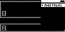
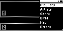
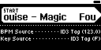
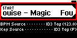
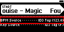
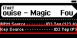

# UI.LIB 
**Library Menu**

## UI.LIB.1 
**State Overview**

### UI.LIB.1.0 

| **Empty** | |
| :--- | :--- |
|  | Library Menu Layout when Library is Empty |

- When Zero's library is totally empty, the only Menu option must be +Add Music

### UI.LIB.1.1 

| **Populated** | |
| :--- | :--- |
|  | Library Menu Layout when Library contains one or more songs |
- When Zero's library has data, menu options will appear based on available data:
    1. Playlists is always present
    2. Artists is always present
    3. Genre is present only if 1 or more songs have Genre data
    4. BPM is present only if 1 or more songs have BPM data
    5. Key is present only if 1 or more songs have Key data
    6. Errors is present only if 1 or more songs have Errors, and Settings/UI/Hide Unplayable Songs = false
    7. +Add Music is always present

## UI.LIB.2
**Playlists Menu**

### UI.LIB.2.0 
**State Overview**
#### UI.LIB.2.0.0 
 **No Playlists in Library**
A Library with no playlists must only show the admin options here.
#### UI.LIB.2.0.1 
 **One or More Playlists in Library**
A Library with one or more playlists must list them all here. The admin options must also be visible.

### UI.LIB.2.1 
**Playlist view**
#### UI.LIB.2.1.0 
 **Empty Playlist**
An playlist with no songs should only have the Admin options visible.
#### UI.LIB.2.1.1 
 **Populated Playlist**
An populated playlist must list all songs here. The admin options must also be visible.
#### UI.LIB.2.1.2 
**+Add Song**
#### UI.LIB.2.1.3
**Rename**
#### UI.LIB.2.1.4
**Delete**
### UI.LIB.2.2
**+Add Playlist**

## UI.LIB.3 
 **Artists Menu**
All songs in Library are grouped in sections alphabetically by Artist then listed by Title.  There should be ~4 px spacing between the end of one Artist section and the beginning of the next.
### UI.LIB.3.0
 **Artist Section Header**
Section headers should be rendered all-caps in narrow 5 px font. Text should overflow off right edge of menu.
### UI.LIB.3.1
 **Song Title**
Song titles should render in white-on-black in regular, mixed-case 5 px font. Text should overflow off right edge of menu. Highlight should reverse text to black on white. Highlighted text should overflow in animated marquee.

## UI.LIB.4 Genre
### UI.LIB.4.1 Genre List
### UI.LIB.4.2 Songs in Genre

## UI.LIB.5 BPM
### UI.LIB.5.0 BPM List

## UI.LIB.6 Key
### UI.LIB.6.0 No Current Key
### UI.LIB.6.1 Current Key

## UI.LIB.7 Errors
### UI.LIB.7.0 Song List

## UI.LIB.8 Song Menu Item
### UI.LIB.8.0 Plain
### UI.LIB.8.1 Annotations
#### UI.LIB.8.1.0 Alert
#### UI.LIB.8.1.1 BPM
#### UI.LIB.8.1.2 Key
#### UI.LIB.8.1.3 Camelot

## UI.LIB.9 Import Modal
### UI.LIB.9.0 Single File Options
#### UI.LIB.9.0.0
 **New Import Options**
XXX
##### UI.LIB.9.0.0.0
 **Start Button**
XXX
##### UI.LIB.9.0.0.1
 **BPM Source**
XXX
##### UI.LIB.9.0.0.2
 **Key Source**
XXX

#### UI.LIB.9.0.1 New Sample Rate Error

#### UI.LIB.9.0.2 New Format Error
#### UI.LIB.9.0.3 Exists
#### UI.LIB.9.0.4 Exists Sample Rate Error
#### UI.LIB.9.0.5 Exists Format Error
### UI.LIB.9.1 File Directory Options
### UI.LIB.9.2 Rekordbox XML Flow
#### UI.LIB.9.2.0 Select RB XML File Dialog
#### UI.LIB.9.2.1 Select RB Contents Dir Dialog
#### UI.LIB.9.2.2 Rekordbox XML Options
### UI.LIB.9.3 Single File Analyze
### UI.LIB.9.4 Batch File Analyze
