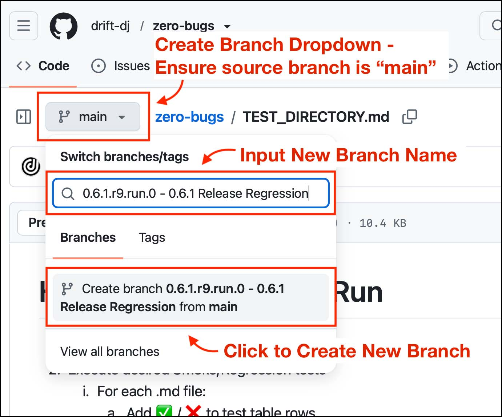
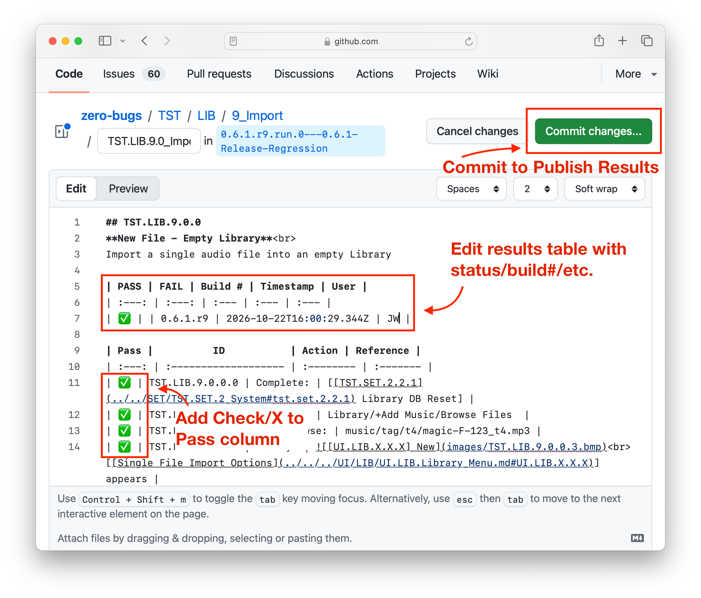

# How to Publish Test Results
### Use the GitHub Web UI to create a new git branch

- **Important:** Ensure source branch is "main"
- Create a single branch to track multiple test runs
    - **Examples:** 
    - A regression run of all test scripts to certify a release version
    - A set of tests to verify a new feature is ready for Beta release
- Give your branch a unique name
    - Lead with release version and test run number
    - Test run number should start at 0 and increment by one with each test run
    - Follow release version and test run number with a brief description
    - Note: spaces aren't allowed in branch names
        - **Examples:**
            - 0.6.1.r9.run.0-Release-Regression-Run-1
            - 0.7.3.r0.run.16-Mixer-UI-Beta-Release-Run-3

### Execute test set and publish results
    1. For each .md file:
        1. Add ✅ / ❌ to test table rows
        2. Edit Results table
            - Add ✅ / ❌ to PASS/FAIL status
            - Add Build #
            - Add ISO-8106 timestamp (use online/LLM generator)
            - Add ID to User column
                - This is a public repo -- avoid email addresses
        3. Edit Notes table (optional)
    2. Commit changes to git branch
    3. Refer/link to your new test branch in related comms/tickets/etc.

